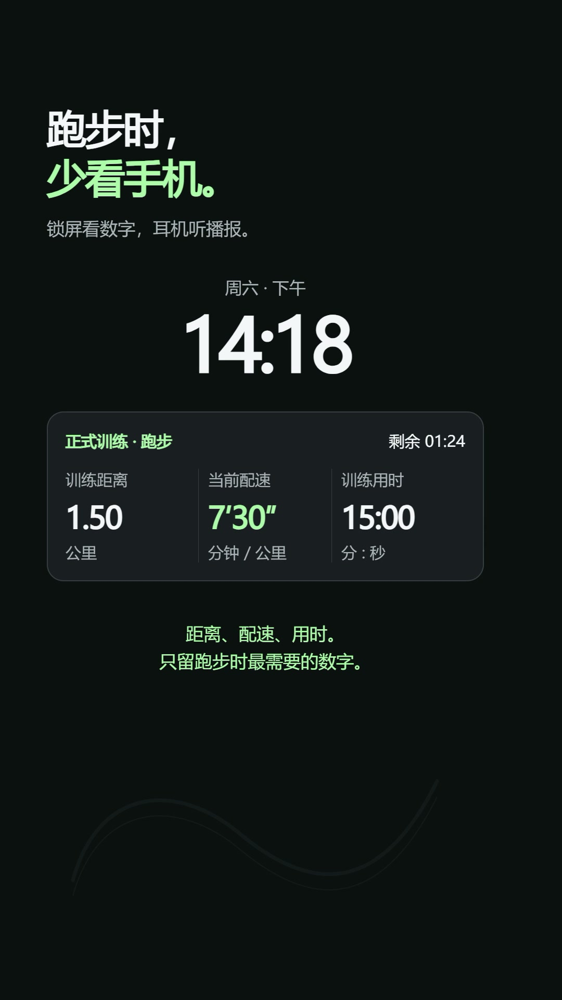

# 慢慢跑 · SlowRun

一个给自己做的中文 iPhone 跑步 App：按计划跑走，锁屏看数据，听离线微软播报，结束后查看每一段。

## 一分钟介绍

**[点击在线直接播放竖屏视频](https://xxsdd.github.io/slowrun/)**，无需下载文件。60 秒，1080×1920，适合手机竖屏观看。

<a href="https://xxsdd.github.io/slowrun/"></a>

[横屏版仍可在线播放](https://xxsdd.github.io/slowrun/media/slowrun.mp4)。

## 已有功能

- 九周渐进新手计划，完成课程后自动推荐下一节。
- 自由跑自定义跑/走时长并无限循环；也可选择 3 公里、5 公里距离跑。
- GPS 路线、距离、平滑当前配速、步频及每公里/末段用时。
- 热身、正式训练、放松分别统计，同时显示全程总计。
- 全程步数与估算活动热量；缺失数据不会冒充为零。
- 锁屏实时活动和灵动岛，保留当前阶段的关键数据与倒计时。
- 内置微软离线语音：9 条固定提示、190 段数字/短语，动态配速在手机本地组合播放。
- 可设置目标配速、播报开关及间隔，跑步阶段的动作提醒。
- 本机训练记录、路线图、配速变化、体感与简记；AI 复盘仅手动触发，可不配置。

不测心率，不连接手环。热量为估算值；入门计划按时间逐渐增加跑步量，不保证九周结束一定跑满 5 公里。

## 构建与使用

源码版本 **0.3.0（build 15）**，SwiftUI + 本地 RunCore Swift 包，最低 iOS 17。用 Mac/Xcode 16 或更新版本打开 `SlowRun.xcodeproj`，或在仓库 Actions 中手动运行 **Build iPhone install package**，使用 macOS runner 构建。

```sh
swift test --package-path RunCore
python scripts/check_project.py
```

源码附带 49 项核心测试。安装到自己的 iPhone 需要自己的 Apple 签名身份；云端构建产出的 unsigned IPA 不能直接点击安装。

- [构建、安装与训练说明](docs/开始使用.md)
- [语音与数据说明](docs/语音与数据.md)
- [可选个人服务](service/README.md)

## 目录

| 路径 | 内容 |
|---|---|
| `SlowRun/` | SwiftUI 页面、GPS/计步、离线语音和实时活动 |
| `RunCore/` | 训练阶段、统计、配速、课程进度及 XCTest |
| `service/` | 可选 Python 服务与 Cloudflare 复盘 Worker |
| `site/` | GitHub Pages 展示页与可在线播放的 MP4 |
| `scripts/` | 工程、音频包及 IPA 检查脚本 |

## 数据与配置

公开版本不包含个人跑步记录、精确路线、账户凭据、证书或签名安装包。App 默认不连接作者的私人云服务。需要 AI 时，使用自己的服务和令牌；上游密钥只放在服务端。`.env.example` 是空配置模板，实际 `.env` 不应提交。

图标与语音等素材沿用个人项目资源；第三方角色及素材的权利归原权利人。视频配乐来自 Brag 本地素材中的 ende.app 曲目，界面音效来自 Kenney。仓库公开不代表第三方素材的权利转让。
